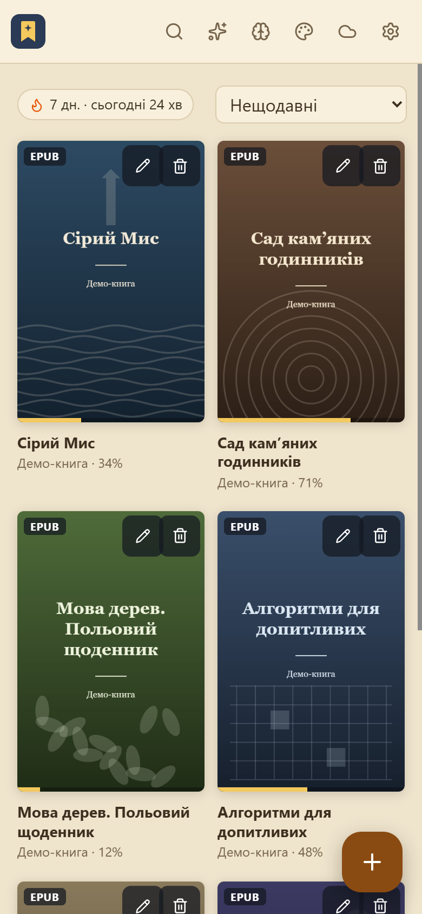
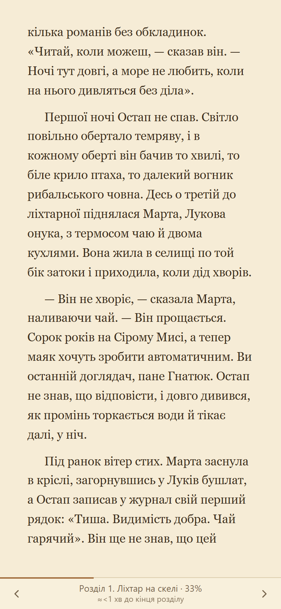
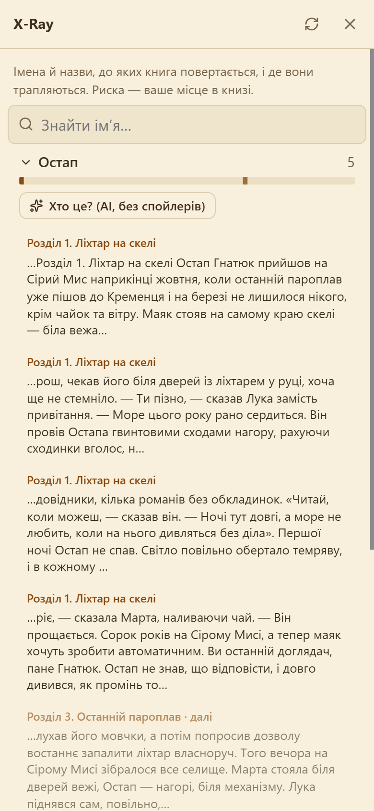
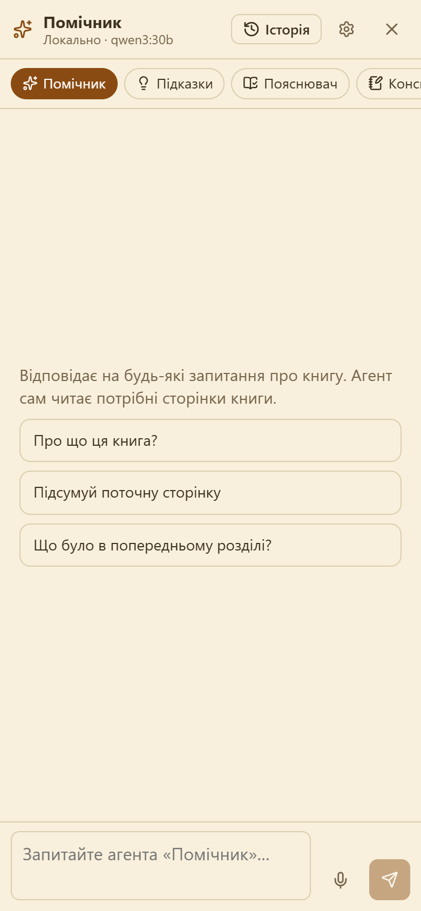
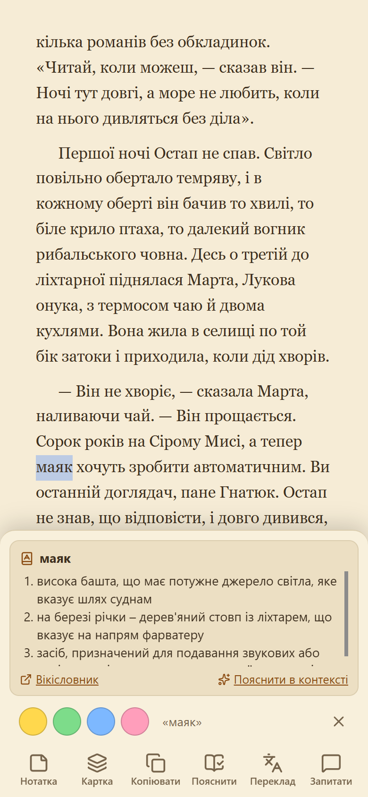
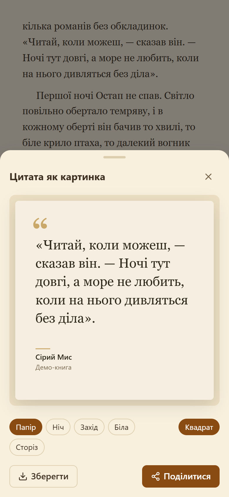
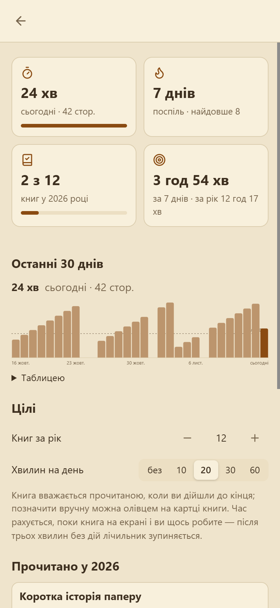
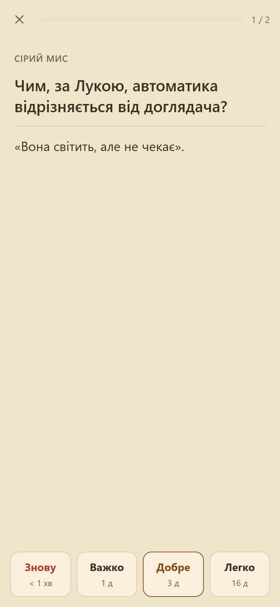
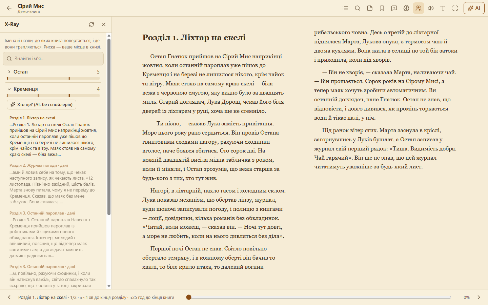

# Закладка — читалка з AI

PWA-читалка для **EPUB, PDF, DjVu, FB2, MOBI і JWPUB** з AI-агентами (Claude, OpenRouter, локальні моделі), нотатками (текст + малюнок), малюванням на сторінках, X-Ray, словником, статистикою читання, картками для запам'ятовування, розпізнаванням сканів, двома видами пошуку — точним і смисловим — та синхронізацією між пристроями через власне S3-сховище (RustFS). Працює офлайн, дані зберігаються в браузері.

**[Відкрити застосунок](https://ivlad003.github.io/zakladka/app/)** · **[Сторінка проєкту з відео](https://ivlad003.github.io/zakladka/)** · ліцензія [MIT](LICENSE)

<p>
  
  
  
  
</p>
<p>
  
  
  
  
</p>



Відео (≈1 хв, телефон): [site/media/demo.mp4](site/media/demo.mp4) — або на [сторінці проєкту](https://ivlad003.github.io/zakladka/). Книжки на знімках — демонстраційні, написані для них.

Онлайн-версія на GitHub Pages працює повністю в браузері: книги, нотатки й ключі лишаються на вашому пристрої. Книжки з репозиторіїв GitHub теж складаються просто в браузері. Збереження статей, вебпошук через сервер і проксі до локальних моделей потребують власного сервера (`npm run serve`, див. нижче).

## Запуск

Потрібен Node.js 20+.

```bash
npm install
npm run dev        # http://localhost:5173
```

Production-збірка та перевірка PWA (service worker працює лише в збірці):

```bash
npm run build
npm run preview    # http://localhost:4173
```

Вміст `dist/` — статичний сайт: його можна викласти на будь-який хостинг із HTTPS, після чого застосунок можна «встановити» з браузера. Для домашнього використання є власний невеликий сервер — див. [«Сервер із проксі до моделей»](#сервер-із-проксі-до-моделей).

## Можливості

**Читання**
- Бібліотека з обкладинками, прогресом, пошуком; додавання файлів кнопкою або перетягуванням. **Полиці**: книгу можна поставити на одну чи кілька (олівець на картці книги), над книгами — перемикач полиць. **Сортування**: нещодавні, за назвою, за автором, за прогресом, нещодавно додані. Там само, під олівцем, виправляються назва й автор.
- Формати: EPUB, PDF, DjVu, **FB2** (також `.fb2.zip` і `.fbz`, у будь-якому кодуванні) та **MOBI / AZW / AZW3 / PRC** без DRM. FB2 і MOBI під час додавання один раз перетворюються на EPUB просто на пристрої — зі змістом, посиланнями, малюнками й обкладинкою — і далі поводяться як звичайний EPUB. Обмеження MOBI: книжки з DRM (куплені в Kindle Store) прочитати не можна; не підтримується стиснення HUFF/CDIC; у AZW3 (KF8) текст і малюнки зберігаються повністю, але посилання між розділами зникають. Конвертер MOBI перевірено лише на файлах, згенерованих за описом формату (`scripts/make-mobi-samples.mjs`), — на справжніх книжках можливі несподіванки.
- **JWPUB** (видання для JW Library): під час додавання файл так само один раз перетворюється на EPUB на пристрої — зі змістом (розділи й частини), малюнками, обкладинкою, примітками (дотик до позначки показує примітку) і посиланнями між документами видання. Біблія у JWPUB читається за книгами й розділами, посилання на вірші всередині неї працюють. Чого немає: посилання на вірші у звичайному виданні стають простим текстом (самих віршів у файлі немає — JW Library бере їх з установленої Біблії), перехресні посилання й відео пропускаються, поля для запису відповідей під запитаннями не переносяться, інтерактивні елементи саморобних видань не працюють. У бібліотеці номер журналу має назву номера («…, січень 2026»), а не тому за рік. Дуже великі файли (навчальна Біблія з усіма ілюстраціями) на телефоні можуть не вміститися в памʼять. Конвертер написано за відкритими описами формату й перевірено на файлах, згенерованих за ними (`scripts/make-jwpub-samples.mjs`), та на одному справжньому номері журналу — на інших виданнях (книжки, Біблія) можливі несподіванки.
- **EPUB, у якому вся книжка — один файл** (так їх складають, зокрема, Leanpub і Pandoc): для читалки «розділ» — це файл, тож така книжка довго відкривалась і гортала ривками, а назва розділу й лічильник сторінок стосувалися всієї книжки. Під час додавання завеликі файли (понад ~250 тис. знаків розмітки) розрізаються на розділи — за заголовками, а де їх немає, на рівні частини; зміст, посилання й виноски перенаправляються на нові файли, текст і малюнки лишаються ті самі. Книжки, додані раніше, не змінюються: щоб отримати розрізану, додайте той самий файл ще раз — вона стане поруч окремою книжкою (місця й нотатки в цілій і розрізаній рахуються по-різному, тому вони не змішуються), а стару можна видалити. Не розрізаються книжки з фіксованими сторінками та окремі неподільні блоки (дуже довга таблиця, список чи лістинг).
- PDF і DjVu: режим сторінок (гортання свайпом, як у книзі) або безперервна прокрутка; масштаб (за шириною / сторінка / довільний, Ctrl + коліщатко або розведення пальців), зміст, перехід на сторінку. На телефоні й планшеті за замовчуванням увімкнено сторінки, на комп'ютері — прокрутку; перемикається в меню «Вигляд».
- **Текстовий режим для PDF і DjVu** («Вигляд» → «Показувати: Текст»): текст сторінок розкладається заново, як в EPUB, — зі шрифтом, розміром, інтервалом і темою на ваш смак, без масштабування. Абзаци й заголовки відновлюються за розташуванням рядків, колонтитули й номери сторінок прибираються, перенесені слова зшиваються. Сторінка оригіналу — це розділ у текстовому режимі, тож місце читання, пошук, нотатки, смисловий індекс і агенти працюють так само, а перемикання повертає на ту саму сторінку. Одна сторінка оригіналу — це кілька екранів тексту, тому в текстовому режимі запам'ятовується ще й місце на самій сторінці (на цьому пристрої): після повернення з «Оригіналу» чи повторного відкриття книжки читання триває з того самого екрана; «Оригінал» відкривається з початку сторінки. Сторінки без тексту показуються картинкою; книжку, що здебільшого складається зі сканів, спершу треба розпізнати (OCR). Малюнки на сторінках із текстом, таблиці й формули видно лише в «Оригіналі»; багатоколонкову верстку не перевіряв. Текстову версію можна зберегти як окрему EPUB-книгу («Зберегти як окрему EPUB-книгу» в тому ж меню).
- **Зміст для книжок без змісту.** Якщо в PDF чи DjVu немає вбудованого змісту, застосунок за секунду-дві після відкриття сам складає його з тексту й зберігає. Спершу шукає друковану сторінку змісту («Зміст», «Содержание», «Contents» — рядки з номерами сторінок на початку чи в кінці книги) і переводить друковані номери в сторінки файлу: за номерами, надрукованими на самих сторінках, а якщо їх немає — знаходячи назви розділів у тексті. Якщо такої сторінки немає, зміст складається за заголовками: рядками, набраними більшим шрифтом, і рядками на кшталт «Розділ 3», «Chapter IV», «Вступ». У панелі «Зміст» видно, звідки він узявся, і є кнопка «Скласти ще раз». Для сканів зміст складеться сам, коли текст буде розпізнано (OCR). Цим змістом користуються й текстовий режим, і агенти.
- EPUB: режим сторінок або прокрутки, розмір і тип шрифту, міжрядковий інтервал, гортання свайпом (сторінка рухається за пальцем), дотиком чи кліком по краях, клавішами. Шрифт «Книги» показує книжку з її власними стилями; «Із зарубками» та «Без зарубок» замінюють шрифт усього тексту, хоч би як наполягали стилі самої книжки (моноширинний код лишається моноширинним).
- **Типографіка EPUB** («Вигляд»): поля (вузькі, звичайні, широкі), вирівнювання (як у книжці, за лівим краєм, за шириною), відступ між абзацами, відстань між літерами, переноси слів. **Власний шрифт**: «Додати свій шрифт» → «Вибрати файл…» — файл TTF, OTF, WOFF чи WOFF2 з пристрою; він зберігається в застосунку (синхронізація його не переносить).
- **Дві сторінки поруч**, як розворот книжки: EPUB на широкому екрані, а також PDF і DjVu в режимі прокрутки (обкладинка окремо, далі пари сторінок). «Вигляд» → «Дві сторінки поруч»: на широкому екрані / ще й на планшеті боком / ніколи. У режимі «Сторінки» для PDF і DjVu розвороту немає.
- **Виноски в спливному вікні**: дотик до посилання на примітку в EPUB (і FB2/MOBI/JWPUB) показує текст примітки знизу, не перегортаючи книжку; «Перейти до примітки» веде на її місце.
- **Скільки лишилося**: унизу видно, скільки хвилин до кінця розділу та книжки. Час рахується з вашої швидкості читання цієї книжки (а поки її мало — із загальної); перші хвилини читання підпису немає.
- **Словник**: виділіть одне слово (подвійний клік або довге натискання) — у меню з'явиться його значення з Вікісловника: українські слова — з українського, англійські — з англійського. Для форм слова («маяка», «сходами») шукається словникова форма. Кнопка «Пояснити в контексті» питає AI, що слово означає саме в цьому реченні. Потрібен інтернет; Вікісловник знає не всі слова.
- **X-Ray** (кнопка з людьми на панелі або «Ще» → «X-Ray»): імена, місця й назви, до яких книжка постійно повертається, — як X-Ray у Kindle. Список складається з тексту на пристрої, без AI і без інтернету: слова з великої літери посеред речення, що повторюються й не трапляються з малої. Для кожного — смужка, де в книжці він з'являється (позначка — де ви зараз), і список згадок із переходом на місце. «Хто це?» просить AI коротко описати героя чи місце лише з уривків до поточного місця, щоб нічого не зіпсувати наперед. Найкраще працює з художньою прозою; у технічних текстах трапляються назви розділів і терміни.
- **Цитата як картинка**: виділіть фрагмент → «Картинка» (у меню на телефоні) або «Цитата як картинка». Чотири стилі, квадрат 1080×1080 або сторіз 1080×1920; «Поділитися» відкриває системне меню (на iPhone — Instagram, Telegram тощо), «Зберегти» завантажує PNG.
- Теми: світла, сепія, темна. Позиція читання запам'ятовується; закладки; повноекранний режим.
- **Читання вголос** («Ще» → «Читати вголос», на комп'ютері — кнопка з динаміком): голосами самого пристрою, без інтернету. Сторінки гортаються самі, речення на межі сторінок дочитується без запинки; є пауза, швидкість, вибір мови й голосу. Якщо погортати самому — читання продовжиться з нової сторінки. Якість і наявність українського голосу залежать від пристрою (на iPhone та Android він є; у Windows — в Edge або після встановлення мовного пакета). Якщо голос не вибрано, читає типовий голос системи для мови; вибраний голос, який так і не заговорив, сам замінюється типовим. **«Не чути?»** у плеєрі каже коротку фразу й показує, що з нею зробив пристрій: почав, договорив, помилка чи нічого (зі сказаним «договорив», але тишею винен приглушений звук). На iPhone там же є «Гучно навіть у беззвучному режимі»: звуковий режим «відтворення», з яким голос чути попри перемикач, але на деяких iPhone він голос, навпаки, глушить, тому за замовчуванням вимкнений.

**Статті «на потім»**
- Кнопка «+» у бібліотеці → «Стаття з інтернету»: вставте адресу — сервер застосунку завантажує сторінку, з неї виділяється сама стаття (Mozilla Readability, як режим читання у Firefox) разом із малюнками, і зберігається як EPUB-книжка на полиці «Статті». Далі вона читається офлайн, як звичайна книжка: нотатки, пошук, AI, читання вголос, синхронізація.
- Посилання можна й перетягнути з браузера на бібліотеку. На Android встановлений застосунок з'являється в меню «Поділитися» браузера; на iPhone такої можливості для вебзастосунків немає — копіюйте адресу.
- Потрібен сервер застосунку (`npm run serve` або dev-сервер): браузер сам не може завантажити чужий сайт. Сторінки за входом чи платною підпискою зберегти не вийде; адрес домашньої мережі сервер не відкриває.

**Книжка з репозиторію GitHub**
- «+» у бібліотеці → «Репозиторій GitHub — книжка або журнал» (або кнопка «Книжка з GitHub» на сторінці «Агент»). Вкажіть `власник/репозиторій` чи вставте посилання з GitHub — на репозиторій, гілку або теку, pull request, порівняння гілок чи окремий коміт; посилання на GitHub, вставлене в поле статті або перетягнуте на бібліотеку, теж відкриває цей діалог.
- **Що читати:** увесь репозиторій на вибраній гілці (або одну теку), pull request зі списку нещодавніх чи за номером, діф двох гілок, окремий коміт.
- **Що зробити:** *Книжка* — модель пояснює проєкт по розділах (що це, як влаштовано, як працює, як запустити), *Журнал* — те саме як номер журналу: головна тема, статті, врізки; *Стаття* — одна стаття про найголовніше (що це за проєкт або що змінює цей діф), написана за один запит до моделі, із власним заголовком; *Код як є* — без AI: файли стають сторінками (README з картинками, зміст за теками), а зміни — діфами з підсвіткою доданих і вилучених рядків. Для pull request і діфів книжка розповідає, що і навіщо змінено, а всі зміни йдуть додатком.
- **Розмір:** коротка (до 4 розділів, ≈10 хв читання), середня (7), докладна (12, близько години); для статті — її довжина (≈3, 6 чи 9 хв читання); для «Код як є» розмір визначає, скільки файлів і змін уміститься. **Мова книжки** — українська, англійська, польська, німецька, іспанська чи французька; код і назви лишаються як є.
- **Картинки й діаграми.** Обкладинка малюється для кожної книжки; на сторінці «Про репозиторій» — карта тек. Діаграми, які модель пише в розділах (Mermaid), застосунок одразу промальовує в картинки й кладе в EPUB, тож їх видно на сторінках книжки в будь-якій темі, в інших читалках і в PDF. Діаграму з помилкою застосунок раз повертає моделі на виправлення; якщо й тоді не малюється — пропускає. У «Код як є» README й інші документи показуються зі своїми картинками (значки-бейджі пропускаються).
- Як це зроблено: спершу модель складає план і призначає кожному розділу файли, потім пише розділи по одному — кожен лише з тексту своїх файлів (скільки вміщає контекст моделі). Тому книжка про великий репозиторій описує головне, а не кожен файл; наприкінці є перелік файлів-джерел. Якщо посеред роботи стався збій, «Продовжити» дописує решту, не починаючи спочатку. Поки книжка пишеться, застосунок краще тримати відкритим.
- Готова книжка стає на полицю «Репозиторії» й читається як звичайна: нотатки, пошук, агенти, читання вголос, синхронізація. **Завантажити** її можна як EPUB або PDF: кнопки в діалозі одразу після створення і під олівцем на картці книжки (файл книжки можна завантажити там для будь-якої книжки, PDF — для складених застосунком). PDF верстається на пристрої (A4, зміст із номерами сторінок, закладки розділів); шрифти для нього завантажуються першого разу.
- Усе працює в браузері, без сервера застосунку: репозиторій, гілки, pull request'и й діфи читаються напряму з GitHub API. Без токена GitHub дає 60 запитів на годину й лише відкриті репозиторії (на книжку йде 5–8 запитів, самі файли в ліміт не входять); для приватних репозиторіїв і більшого ліміту додайте токен GitHub із доступом на читання — поле «Токен GitHub» є в налаштуваннях AI і в самому діалозі, з кнопкою «Вставити», яка бере токен із буфера обміну (на телефоні не треба ні клавіатури, ні довгого натискання; працює, коли застосунок відкрито через HTTPS). Токен зберігається лише в цьому браузері. Чого немає: інших git-хостингів (GitLab тощо) і локальних репозиторіїв; дуже великі pull request'и GitHub віддає не повністю (до 300 файлів, великі діфи без тексту змін).
- Якість книжки залежить від моделі. Перевірено на імітації моделі та на локальній Qwen2.5 7B (LM Studio): 7B складає план і пише розділи, але переказує поверхово, плутає мови й рідко дає придатну діаграму — для книжки беріть сильнішу модель. З Claude та OpenRouter на справжньому ключі не перевірялося.

**Статистика** (плашка «… дн. · сьогодні …» у бібліотеці)
- Час читання й сторінки за день (графік за 30 днів, є й таблицею), серія днів поспіль і найдовша серія, ціль на день у хвилинах і ціль на рік у книжках, прочитані цього року, швидкість і час до кінця по кожній книжці.
- Час рахується, лише поки книжка відкрита на екрані й ви щось робите: після трьох хвилин без жодного дотику лічильник зупиняється. День зараховується до серії з однієї хвилини читання.
- Книжка вважається прочитаною, коли ви дійшли до кінця; позначку можна поставити й зняти вручну (олівець на картці книжки → «Прочитано»).
- Журнал читання синхронізується: кожен пристрій пише свої рядки, тож хвилини з телефона й комп'ютера додаються, а не дублюються.

**Нотатки**
- Виділення тексту чотирма кольорами, нотатки до фрагмента або до сторінки; у кожній нотатці — текст і малюнок від руки.
- Малювання просто на сторінках PDF/DjVu: олівець, маркер, гумка, скасування.
- Список усіх нотаток і закладок, експорт у Markdown.

**Пошук**
- *Точний* — слова й фрази по всьому тексту з підсвіткою збігів.
- *Смисловий* — знаходить фрагменти за змістом, навіть якщо в них інші слова. Книгу один раз індексують; індекс (векторна база) лежить в IndexedDB і переглядається повним перебором — для книги це мілісекунди.
- *У всіх книгах одразу* — кнопка з лупою в бібліотеці (або Ctrl+F): той самий точний і смисловий пошук, але по всій бібліотеці, незалежно від формату — EPUB, PDF і DjVu разом. Результати згруповано за книгами; дотик до результату відкриває книгу на знайденому місці з підсвіткою, а після повернення пошук лишається відкритим. Текст кожної книги зчитується один раз і зберігається; для смислового пошуку є кнопка «Проіндексувати решту».

**Скани (OCR)**
- Кнопка OCR у читалці розпізнає текст на сторінках без текстового шару (Tesseract, працює на пристрої; українська, англійська та інші мови).
- Після цього на сканах працюють пошук, виділення, нотатки, смисловий пошук і AI-агенти. Сторінки з наявним текстом пропускаються, роботу можна зупинити й продовжити.

**AI-агенти** (панель «AI»): Помічник, Підказки, Пояснювач, Конспект, Репетитор, Перекладач. Є ще **Налаштування** — агент, який налаштовує застосунок за вашим описом («зроби темну тему й більший шрифт», «підключи Ollama») і перевіряє адреси; ключів і паролів він не бачить і змінити не може. Окремо — **Тренер пам’яті**: робить картки з прочитаного, ставить питання до читання, перевіряє пригадане й придумує образи для палацу пам’яті.

**Сторінка «Агент»** (кнопка з іскрами в бібліотеці) — розмова про всю бібліотеку, без відкритої книги: **Бібліотекар** шукає в усіх книгах одразу — точно або за змістом, — каже, де що написано, і пропонує кнопку «Відкрити» на знайденому місці. Його ж можна попросити зробити книжку з GitHub («зроби короткий журнал про pull request 12 у власник/репозиторій»): він сам подивиться репозиторій, складе книжку (над розмовою видно, як просувається робота) і запропонує її відкрити. Те саме робить кнопка «Книжка з GitHub» угорі сторінки — з формою замість розмови; вона ж знадобиться, якщо модель не вміє користуватися інструментами. Там само доступні агент **Налаштування** і власні агенти.

**Розширені налаштування агентів** («Налаштування AI» → «Розширені: інструкції агентів»): видно й можна змінити роль кожного агента, спільний стиль відповідей і додати власні інструкції для всіх (наприклад, «звертайся на ти», «пояснюй на прикладах із програмування»). Там само створюються **власні агенти** — назва, опис, де доступний (у книзі, у бібліотеці чи всюди) і інструкції; вони користуються тими самими інструментами, що й вбудовані. Опис книги й інструментів змінити не можна — без нього агенти не зможуть читати книгу. Зміни діють для нових розмов: розпочата розмова зберігає інструкції, з якими почалася. Агент «Налаштування» інструкцій не бачить і змінити їх не може.

**Чат з агентами**
- *Історія розмов.* Кожна розмова зберігається; кнопка з годинником у панелі AI показує розмови цієї книги або всі й шукає в них. Пошук по розмовах є й у пошуку бібліотеки (вкладка «Розмови»). Розмови синхронізуються між пристроями разом з усім іншим.
- *Діаграми.* Коли схему показати простіше, ніж описати, агент малює її (Mermaid): блок-схеми, послідовності, карти думок, часові шкали.
- *Пошук в інтернеті.* Агент із підтримкою інструментів може глянути довідку поза книгою. За замовчуванням («Автоматично») — справжній веб-пошук через сервер застосунку (`npm run serve`): сервер сам питає DuckDuckGo й уміє відкрити знайдену сторінку та віддати її текст. Якщо застосунок відкрито не через свій сервер або пошуковик відмовив автоматичному запиту — відповідає Вікіпедія. Можна вказати й власний SearXNG. Сервер не прикидається людиною (називає себе автоматичним клієнтом), пам'ятає недавні запити й не відкриває адрес домашньої мережі.
- *AI пише чернетку.* У вікні нотатки — «Написати з AI» (або «Доповнити з AI», якщо ви вже щось написали); у картці — «Запитання від AI» чи «Відповідь від AI».
- *Голосове введення.* Кнопка мікрофона в полі запитання й у нотатках — там, де браузер уміє розпізнавати мовлення (Chrome, Edge, Safari). В інших випадках на телефоні диктуйте кнопкою мікрофона на клавіатурі.

**Навчання** — щоб вивчити тему, а не просто прочитати: картки з повторенням за розкладом (алгоритм FSRS), палаци пам’яті та покроковий метод із питаннями до читання й пригадуванням. Докладніше — [нижче](#навчання-картки-повторення-палаци-памяті).

**Синхронізація** — книги, місце читання, нотатки, малюнки, а також картки й палаци пам’яті зберігаються у вашому S3-сумісному сховищі та з'являються на всіх пристроях. Докладніше — [нижче](#синхронізація-між-пристроями-rustfs--s3).

## Провайдери AI

Вибираються в налаштуваннях AI (шестерня в панелі AI або в бібліотеці). Усі адреси й моделі задаються там само. Ключі зберігаються в `localStorage` цього браузера.

| Провайдер | Що потрібно | Що можна змінити |
|---|---|---|
| **Claude** | ключ Claude API | Модель — зі списку або власний id (за замовчуванням `claude-opus-5-5`). Адреса API — якщо звертаєтеся через шлюз чи проксі; порожня означає `api.anthropic.com`. |
| **OpenRouter** | ключ OpenRouter (і для безкоштовних моделей) | Модель — із каталогу, що завантажується наживо (фільтри «безкоштовні» та «з інструментами»), або id вручну. Адреса API — можна вписати інший хмарний сервіс з OpenAI-сумісним API. |
| **У браузері** | місце під модель (0,5–6,4 ГБ) | Модель завантажується один раз із Hugging Face й працює на самому пристрої, без сервера й без інтернету. Два види: **на процесорі** ([wllama](https://github.com/ngxson/wllama), 0,5–1,1 ГБ) — працює в будь-якому сучасному браузері, зокрема на iPhone; **на відеочипі** ([WebLLM](https://github.com/mlc-ai/web-llm), потрібен WebGPU) — у рази швидше, моделі до 6,4 ГБ. Моделі малі: разом із запитанням отримують текст поточної сторінки та (якщо для книги побудовано смисловий індекс) кілька доречних фрагментів з інших місць, але інструментами (пошук по книзі, нотатки, картки, інтернет) не користуються. |
| **Локальні моделі** | запущений OpenAI-сумісний сервер: Ollama, LM Studio, llama.cpp | Адреса сервера (за замовчуванням `http://localhost:11434/v1`), модель зі списку сервера, ключ, розмір контексту. Текст книги не залишає ваших пристроїв. |

У розділі «Локальні моделі» є кнопка **«Знайти автоматично»**: вона перевіряє проксі застосунку та звичні адреси Ollama й LM Studio і сама заповнює адресу та модель.

Для локальних моделей і OpenRouter є два перемикачі:
- **Підтримує інструменти** — модель сама читає сторінки, шукає й зберігає нотатки. Якщо модель цього не вміє, застосунок помітить це сам і надалі надсилатиме їй текст поточної сторінки разом із запитанням.
- **Бачить зображення** — дозволяє агентові дивитися на сторінку (скани, формули).

### Ollama

```bash
ollama pull <модель>          # для агентів беріть модель із позначкою tools
ollama pull bge-m3            # якщо хочете рахувати ембединги для смислового пошуку в Ollama
```

- Стандартний контекст Ollama — 4096 токенів, для книг цього мало: запустіть з `OLLAMA_CONTEXT_LENGTH=16384` (і оберіть відповідний «розмір контексту» в налаштуваннях).
- Якщо застосунок відкрито не з `localhost` і без проксі з цього README, дозвольте йому запити: `OLLAMA_ORIGINS=https://ваш-сайт`.
- Якщо `ollama serve` падає з помилкою `bind: The requested address is not valid`, у змінній `OLLAMA_HOST` записана адреса, якої на комп'ютері вже немає. Задайте `127.0.0.1` (або `0.0.0.0`, якщо потрібен доступ із локальної мережі).
- Якість агентів залежить від моделі. На перевірці `qwen2.5:32b` впевнено шукала й читала книгу, а `llama3.2` (3 млрд параметрів) плуталася в аргументах інструментів і відповідала поверхово.

### LM Studio

Увімкніть локальний сервер (вкладка Developer) і вкажіть його адресу в налаштуваннях — порт видно там само (типово `1234`, але буває інший), наприклад `http://localhost:1234/v1`. Кнопка «Перевірити» покаже завантажені моделі. Для чату потрібна завантажена LLM, для смислового пошуку — модель ембедингів.

**Перевірено з LM Studio** (його сервер на цьому ж комп'ютері, застосунок відкрито з телефона через `…/proxy/lmstudio/v1`): у налаштуваннях кнопка «LM Studio через проксі» показує моделі, ембединг-моделі позначено й поставлено в кінець списку, щоб випадково не обрати їх для чату. LM Studio сам завантажує модель при першому запиті й вивантажує після години простою — тримати її завантаженою не треба.

Який розмір моделі потрібен агентам (перевірено на тестовій книзі, по кілька спроб):
- **Qwen2.5 7B** (4,7 ГБ): Бібліотекар знаходить місця й дає кнопку «Відкрити» щоразу; Помічник відповідає з цитатами, але на запитання з двох частин часто відповідає лише на одну; Тренер пам'яті здебільшого пише картки текстом замість зберегти їх, а збережені іноді не проходять перевірку (застосунок не зберігає картку, якщо її цитати немає в книзі, якщо відповідь не випливає з цитати або якщо питання вже містить відповідь).
- **Qwen2.5 32B** (через Ollama, 20 ГБ): Тренер робить і зберігає картки, ставить питання до читання, придумує образи для палацу пам'яті.

Застосунок підстраховує малі моделі: виклик інструмента, написаний текстом, виконує як виклик; коли модель лише обіцяє щось зробити або замовкає після результатів пошуку, один раз просить її продовжити; фразу, якої немає в книзі, шукає ще й по окремих словах.
## Навчання: картки, повторення, палаци пам’яті

Кнопка з мозком у бібліотеці (на ній — кількість карток, яким час) або «Навчання» в читалці.

**Тема** — те, що ви вивчаєте: книга, розділ чи щось своє. На сторінці теми — метод по кроках:

1. **Питання до читання.** «Тренер пам’яті» ставить 4–5 питань ще до читання; ви пробуєте відповісти.
2. **Прочитати** — із цими питаннями в голові.
3. **Пригадати без книги.** Записуєте все, що пам’ятаєте; тренер звіряє з текстом, показує прогалини й робить для них картки.
4. **Картки.** Власноруч, із виділеного в книзі тексту (кнопка в меню виділення) або згенеровані тренером із розділу.
5. **Палац пам’яті.** Картки розкладаються на зупинках знайомого маршруту; до кожної — яскравий образ: словами (свій або від тренера) і, за бажання, малюнком від руки, який показується разом із відповіддю. «Прогулянка» проводить маршрутом по порядку.
6. **Повторення за розкладом.** Відповідь схована, поки ви не спробуєте згадати; далі оцінка «Знову / Важко / Добре / Легко» — і картка повертається тоді, коли ви майже готові її забути. Забуте повертається ще в тій самій сесії. Картки з різних тем ідуть упереміш.

**Розклад** рахує алгоритм [FSRS-5](https://github.com/open-spaced-repetition/awesome-fsrs/wiki/The-Algorithm) (модель «складність — стабільність — імовірність пригадування», стандартні параметри авторів). **Розклад підлаштовується під вас:** перші інтервали нових карток (скільки тримається картка після першої відповіді «Знову / Важко / Добре / Легко») оцінюються з вашого власного журналу повторень — так само, як це робить перший крок оптимізатора FSRS, — щойно назбирається щонайменше 8 карток з однаковою першою відповіддю, побачених знову в інший день. Оцінка обережна: мало даних — майже типове значення. Решта параметрів лишається стандартною. Вимикається в налаштуваннях навчання. Бажану ймовірність пригадування (80–95%) і кількість нових карток на день задаєте самі. Прогулянка палацом — це тренування: розклад вона змінює лише для карток, яким уже час.

**На чому це ґрунтується** (ті самі посилання є в застосунку):
- пригадування ефективніше за перечитування — Roediger & Karpicke, 2006, *Psychological Science*; Karpicke & Blunt, 2011, *Science*;
- повторення з інтервалами — Ebbinghaus, 1885; Cepeda et al., 2006, *Psychological Bulletin*; алгоритм FSRS — Ye, Su & Cao, 2022, *KDD*;
- метод місць — Dresler et al., 2017, *Neuron*; Wagner et al., 2021, *Science Advances*;
- питання до читання — Richland, Kornell & Kao, 2009, *J. Exp. Psychology: Applied*;
- чергування тем — Rohrer & Taylor, 2007, *Instructional Science*;
- огляд технік навчання — Dunlosky et al., 2013, *Psychological Science in the Public Interest*.

Кроки з AI (питання, перевірка пригаданого, генерація карток, образи) потребують налаштованого провайдера й книги, прив’язаної до теми; решта працює без AI й офлайн.

## Смисловий пошук: ембединги

У налаштуваннях AI є два варіанти:
- **У браузері** (за замовчуванням) — багатомовна модель `Xenova/multilingual-e5-small`. Під час першого індексування завантажуються бібліотека transformers.js (з CDN jsDelivr, версія зафіксована) і ваги моделі з Hugging Face, близько 120 МБ; далі все працює офлайн і текст нікуди не надсилається. Id моделі можна змінити на будь-яку модель ембедингів з ONNX-вагами (наприклад, легшу англомовну `Xenova/all-MiniLM-L6-v2`).
- **На сервері моделей** — будь-який OpenAI-сумісний `/embeddings`: Ollama (`bge-m3`), LM Studio, OpenRouter. Адреса, модель і ключ задаються окремо від чату.

Після зміни моделі ембедингів індекс книги треба побудувати заново; після OCR — оновити.

## Синхронізація між пристроями (RustFS / S3)

Кнопка з хмаринкою в бібліотеці. Потрібне S3-сумісне сховище: [RustFS](https://rustfs.com), MinIO, будь-яке інше. Браузер звертається до нього напряму за стандартним S3 API (підпис SigV4, адреси виду `адреса/бакет/ключ`); окремого сервера синхронізації немає.

**Що синхронізується:** файли книг з обкладинками, місце читання, виділення, нотатки, закладки, малюнки на сторінках, розпізнаний текст сканів (OCR); виправлені назва, автор і полиці книги, позначка «прочитано»; журнал читання (статистика); теми, картки з розкладом, палаци пам’яті та журнал повторень; розмови з агентами.
**Що залишається на пристрої:** ключі та всі налаштування, індекси смислового пошуку й X-Ray (їх можна перебудувати), власний шрифт, завантажені моделі.

Як це працює:
- На кожному пристрої вкажіть ті самі адресу, бакет і ключі. Синхронізація запускається під час старту, після закриття книги, коли застосунок згортають або розгортають, і кожні 5 хвилин; є й кнопка «Синхронізувати».
- Книга, додана на одному пристрої, з'являється на інших одразу як запис з обкладинкою (позначка хмаринки), а сам файл завантажується, коли її вперше відкривають. Файл можна знову прибрати з пристрою, залишивши книгу в бібліотеці.
- Теми, картки (разом із розкладом повторень) і палаци пам’яті синхронізуються так само: повторили картку на телефоні — на комп’ютері вона вже не чекає.
- Зміни зливаються поелементно: кожна нотатка, кожна сторінка малюнків і позиція читання мають власну позначку часу, і перемагає новіша. Нотатки, додані на двох пристроях одночасно, зберігаються обидві. Видалення поширюється на інші пристрої.
- Якщо книга відкрита, а з іншого пристрою прийшла новіша позиція, читалка не стрибає сама, а пропонує перейти.
- Розмова з агентом — один об'єкт у сховищі; якщо ту саму розмову продовжили на двох пристроях між синхронізаціями, лишається пізніша версія. Журнал повторень лише доповнюється, тож два журнали просто об'єднуються.
- Ідентифікатор книги — хеш її файлу, тож той самий файл, доданий на двох пристроях окремо, вважається однією книгою.
- Порівняння «новіше/старіше» спирається на годинники пристроїв — тримайте на них автоматичний час.

### Підготовка RustFS

```bash
docker run -d --name rustfs -p 9000:9000 -p 9001:9001 -v rustfs-data:/data \
  -e RUSTFS_ACCESS_KEY=<ваш ключ> -e RUSTFS_SECRET_KEY=<ваш секрет> \
  -e RUSTFS_CORS_ALLOWED_ORIGINS=http://localhost:8787 \
  rustfs/rustfs:latest
```

- S3 API — порт `9000` (саме його вказуйте в застосунку), вебконсоль — `9001`.
- `RUSTFS_CORS_ALLOWED_ORIGINS` — адреси, з яких відкривається застосунок, через кому (наприклад, `http://localhost:8787,https://pc.ваша-мережа.ts.net`). Без цього браузер блокує запити. Після зміни перезапустіть RustFS.
- Бакет можна створити просто з діалогу синхронізації: «Перевірити» → «Створити бакет».
- Перевірено з RustFS 1.0.5 у Docker: створення бакета, двостороння синхронізація між двома пристроями, завантаження файлу книги.
- Для телефонів і планшетів сховище має відповідати за адресою `https://` (див. наступний розділ).

## Телефон і планшет (iPhone, iPad, Android)

Застосунок — звичайний PWA: відкривається в Safari чи Chrome і встановлюється на головний екран (iOS: «Поділитися» → «На початковий екран»; Android: «Встановити застосунок»). Малювати можна пальцем або стилусом, виділення тексту працює довгим натисканням.

На вузькому екрані читалка поводиться як мобільний застосунок:
- **Сторінка на весь екран.** Верхня й нижня панелі лежать поверх сторінки й ховаються, щойно ви починаєте читати; дотик до середини екрана повертає їх. Унизу — вкладки «Зміст», «Пошук», «AI», «Нотатки», «Ще».
- **Гортання.** Свайп ліворуч чи праворуч — сторінка рухається за пальцем; дотик до правого чи лівого краю теж гортає. Збільшену сторінку палець пересуває, а гортає її різкий свайп від краю.
- **Меню для виділеного тексту.** Виділіть текст довгим натисканням — унизу екрана з’явиться панель дій: колір підсвітки, «Нотатка», «Картка», «Копіювати», «Пояснити», «Переклад», «Запитати». Системне меню телефона (Копіювати, Знайти…) лишається біля самого виділення й не заважає. Дотик до наявної підсвітки відкриває таку саму панель для неї.
- **Свайп двома пальцями.** Два пальці, проведені разом ліворуч чи праворуч будь-де на сторінці, гортають її — в EPUB, PDF і DjVu, у режимі сторінок і в прокрутці, навіть коли сторінку збільшено й один палець її пересуває. Щипок двома пальцями, як і раніше, змінює масштаб (у EPUB — розмір шрифту). Вимикається в «Вигляд» → «Гортання».
- **Смуга для свайпу.** Під сторінкою є смуга з позицією в книзі, а вздовж країв екрана — вузькі зони. Вони належать самому застосунку, а не сторінці книги, тому свайп по них гортає й там, де браузер залишає жести на сторінці собі (Safari на iPhone). Сторінка рухається за пальцем; дотик до лівої чи правої третини смуги теж гортає, до середини — показує меню. Зони біля країв заодно не дають Safari сприйняти свайп як «назад».
- **Способи гортання на вибір** (меню «Вигляд» → «Гортання»): свайп, дотик до країв і плаваючі кнопки — у будь-якому поєднанні. Плаваючі кнопки перетягуються за «ручку» куди зручно й запам’ятовують місце; одне натискання гортає сторінку, утримання — гортає швидко. Можна змінити їхній розмір, розташувати стовпчиком і додати кнопки «Меню», «Закладка», «Зміст», «AI».
- **Панелі самі ховаються** за кілька секунд після відкриття книги, щоб не закривати текст; повертає їх дотик до середини екрана або кнопка «Меню».
- **Якщо жест не спрацьовує**, увімкніть там само «Показувати, що бачить застосунок під час дотиків» — зверху з’явиться рядок із тим, які дотики дійшли й що застосунок із ними зробив.
- **Масштаб.** Розведення пальців збільшує сторінку PDF/DjVu або шрифт EPUB. Сам інтерфейс не масштабується й не «гумить» під час прокрутки.
- **Картинку можна роздивитися.** Дотик (або клік) по картинці в EPUB, FB2, MOBI чи в текстовому режимі PDF і DjVu відкриває її на весь екран: двома пальцями збільшуйте й зменшуйте, одним — пересувайте, подвійний дотик наближає місце під пальцем і повертає назад; є кнопки «−» і «+», а на комп’ютері — коліщатко миші й клавіші `+`, `−`, `0`, стрілки. Закрити: хрестик, дотик поруч із картинкою, свайп униз або Esc. Якщо сторінки гортаються дотиком до країв екрана, то над картинкою краї й далі гортають (інакше зі сторінки-картинки не вийти дотиком), а відкривається вона з частини, ближчої до середини екрана. У текстовому режимі сторінка-картинка зберігається завширшки 1000 пікселів — дрібніші деталі видно в «Оригіналі».
- **Панелі й діалоги** виїжджають знизу; зміст, пошук, нотатки й чат з AI відкриваються на весь екран.

Що варто знати:
- **Оновлюється сам.** Відкритий застосунок раз на 15 хвилин (і щоразу, коли його розгортають) перевіряє, чи є нова версія, завантажує її у фоні й перемикається в безпечний момент: коли ви в бібліотеці або згорнули застосунок, і ніколи посеред відповіді AI, розпізнавання, індексації, синхронізації чи набору тексту. Якщо ви саме читаєте, з’являється ненав’язлива плашка з кнопкою «Оновити зараз». Яка версія працює на пристрої, видно внизу бібліотеки й наприкінці налаштувань AI: номер, коміт і час збірки, поруч — «Перевірити оновлення». Перші два числа номера беруться з `package.json`, третє — кількість комітів, тож воно росте саме з кожною зміною; «+» наприкінці означає збірку з іще не закомічених файлів.
- **Встановлення й робота офлайн потребують HTTPS.** За адресою `http://192.168.x.x` застосунок працює як звичайна сторінка (читання, нотатки, синхронізація), але без встановлення й офлайн-режиму.
- **Сторінка, відкрита через HTTPS, не може звертатися до адрес `http://`.** Тому з телефона до Ollama чи RustFS у домашній мережі напряму не дістатися — потрібна адреса `https://`. Найпростіше це вирішує сервер із проксі з наступного розділу разом із Tailscale.
- **«localhost» на телефоні — це сам телефон.** Локальні моделі працюють на комп'ютері, тож у налаштуваннях AI на телефоні вказуйте адресу комп'ютера (через проксі).
- **Сховище на iOS.** Safari може стерти дані сайту, яким не користувалися кілька тижнів; на встановлений на головний екран застосунок це не поширюється. Синхронізація — ще й резервна копія.
- **Важкі операції** (OCR цілої книги, побудова смислового індексу в браузері, локальні LLM) краще запускати на комп'ютері: розпізнаний текст синхронізується, а моделі доступні з телефона через проксі.
- Потрібні сучасні браузери: iOS/iPadOS 16.4+ (краще 17+), актуальний Chrome на Android.

### Сервер із проксі до моделей

```bash
npm run build
npm run serve            # http://localhost:8787 — лише цей комп'ютер
npm run serve -- --lan   # також http://<ip-комп'ютера>:8787 у домашній мережі
```

`scripts/serve.mjs` (без залежностей) роздає `dist/` і за тією ж адресою пересилає запити до серверів моделей на цьому комп'ютері:

| Адреса в налаштуваннях AI | Куди веде |
|---|---|
| `<адреса застосунку>/proxy/ollama/v1` | Ollama, `http://127.0.0.1:11434` |
| `<адреса застосунку>/proxy/lmstudio/v1` | LM Studio; порт береться з його налаштувань (типово `1234`) |

Інші сервери й порти додаються так: `npm run serve -- --proxy llama=http://127.0.0.1:8080` (так само можна перевизначити `ollama` чи `lmstudio`). Якщо застосунок відкрито з цього сервера, у налаштуваннях AI з'являються готові кнопки «… через проксі». Через проксі моделям не потрібні `OLLAMA_ORIGINS` та інші налаштування CORS, а самі сервери моделей можуть слухати лише `127.0.0.1`.

Той самий сервер шукає в інтернеті для агентів: `/web/search?q=…` (DuckDuckGo, без ключа) і `/web/read?url=…` (текст сторінки), а для статей «на потім» віддає сторінку цілком (`/web/page?url=…`) і її малюнки (`/web/fetch?url=…`, лише зображення до 8 МБ); код — у `scripts/web.mjs`. Запити називають себе автоматичними, недавні відповіді пам'ятаються 15 хвилин, між запитами до пошуковика — пауза; адреси домашньої мережі й самого комп'ютера сервер не відкриває.

З прапорцем `--lan` застосунок і моделі доступні всім у вашій мережі — вмикайте його лише в довіреній.

**Автозапуск у Windows.** Щоб сервер стартував сам після входу в систему, один раз запустіть із теки проєкту (після `npm run build`):

```powershell
powershell -ExecutionPolicy Bypass -File scripts\autostart.ps1            # додати й запустити
powershell -ExecutionPolicy Bypass -File scripts\autostart.ps1 -Remove    # прибрати
```

Скрипт створює завдання Планувальника для вашого облікового запису (без прав адміністратора), яке вказує на цю теку: якщо перенесете проєкт — запустіть скрипт ще раз із нового місця.

**HTTPS через Tailscale** (якщо комп'ютер і телефон в одній tailnet-мережі; у консолі Tailscale має бути ввімкнено HTTPS-сертифікати). Під час запуску `npm run serve` сам підказує потрібну команду й адресу вашого комп'ютера в мережі:

```bash
tailscale serve --bg 8787                                  # застосунок і моделі: https://<комп'ютер>.<мережа>.ts.net
tailscale serve --bg --https=9443 http://127.0.0.1:9000    # RustFS: https://<комп'ютер>.<мережа>.ts.net:9443
```

Тоді на телефоні: застосунок — `https://<комп'ютер>.<мережа>.ts.net`, локальні моделі — `…/proxy/ollama/v1`, сховище — `https://<комп'ютер>.<мережа>.ts.net:9443`, а в `RUSTFS_CORS_ALLOWED_ORIGINS` — адреса застосунку.

Найперше відкриття адреси триває до пів хвилини: Tailscale отримує сертифікат. Правило зберігається після перезавантаження комп'ютера; сам сервер (`npm run serve`) треба запускати знову. Вимкнути доступ: `tailscale serve --https=443 off`.

## Безпека вмісту книг

Сторінки EPUB показуються у фреймі, якому дозволено виконувати скрипти: інакше Safari не передає з нього жодних подій — ні дотиків, ні клавіш. Власні скрипти книги при цьому не виконуються: у кожен розділ перед показом вставляється політика `Content-Security-Policy: script-src 'none'`, а теги `<script>` вирізаються. Діаграми в чаті малюються в режимі `securityLevel: strict`.

## Структура

```
src/
  engines/      pdf.ts (PDF.js), epub.ts (epub.js), djvu.ts + djvu.worker.ts (djvu-rs),
                djvu-outline.ts + zp-tables.ts (власний читач змісту DjVu), ocr-engine.ts (шар OCR),
                fb2.ts і mobi.ts (FB2 та MOBI/AZW → EPUB на пристрої), jwpub.ts + sqlite.ts (JWPUB → EPUB:
                розшифрування тексту й власний читач бази SQLite), reflow.ts (текстовий режим PDF/DjVu),
                epub-build.ts (збирання EPUB), epub-split.ts (розрізання завеликих файлів EPUB на розділи
                під час додавання), epub-mapping.ts (пошук місця сторінки без перебору всього розділу —
                замість того, що робить epub.js)
  components/   Library + BookInfoDialog (полиці, назва, автор, завантаження), LibrarySearch (пошук у всіх книгах),
                AgentPage + LibraryAssistant (сторінка «Агент»: AI без відкритої книги),
                RepoBookDialog (книжка з репозиторію GitHub), Study + StudyReview + CardEditor (навчання),
                Reader, PagedView (PDF/DjVu: сторінки або прокрутка), EpubView, SwipeZones, TurnButtons,
                ReadAloudBar, SidePanel, NoteEditor, SketchPad, InkSurface, AiPanel, ChatHistory,
                AiSettings, SyncDialog, OcrDialog, UpdateToast, AppVersion (номер версії), Stats (статистика),
                AddSheet (книги й статті), QuoteCard (цитата-картинка), ImageViewer (картинка з книжки на
                весь екран), DictionaryCard, XrayPanel, …
  ai/           agents.ts (ролі), tools.ts (інструменти: книга, бібліотека, картки, інтернет, налаштування),
                providers.ts, anthropic.ts (Claude API), openai.ts (OpenRouter, локальні сервери й моделі в
                браузері), browser-llm.ts (wllama на процесорі, WebLLM на відеочипі), quick.ts, run.ts,
                complete.ts (один текст від моделі без розмови й інструментів — для розділів книжки)
  lib/          імпорт книг, малювання, нотатки, ocr.ts, semantic.ts + embed.worker.ts,
                fsrs.ts (розклад повторень), fsrs-fit.ts (підлаштування під читача), study.ts (теми,
                картки, палаци), read-aloud.ts + visible-text.ts (читання вголос), websearch.ts,
                library-search.ts (текст книг і пошук по бібліотеці), auto-toc.ts (зміст для книжок без нього),
                stats.ts (час і сторінки читання), articles.ts (статті → EPUB), dictionary.ts (Вікісловник),
                github.ts (репозиторій, гілки, pull request'и й діфи з GitHub API), repo-book.ts (книжка з
                репозиторію: добір файлів, план, розділи, складання EPUB) + repo-book-words.ts (підписи
                мовами книжки), book-pages.ts (Markdown → сторінки книжки, діфи), book-cover.ts (обкладинка),
                diagram.ts (діаграми Mermaid: у чаті й картинками в книжці), book-export.ts (завантаження EPUB і PDF),
                xray.ts (імена й місця в книжці), chats.ts, jump.ts,
                gestures.ts (свайпи, дотики, щипок), update.ts + busy.ts (автооновлення), version.ts (яка це збірка),
                s3.ts (клієнт сховища), sync.ts + study-sync.ts + chat-sync.ts (синхронізація),
                hash.ts, subtle-shim.ts
  db.ts         IndexedDB (Dexie): книги, файли, нотатки, малюнки, розмови, OCR, векторні індекси,
                тексти книг для пошуку, теми, картки, палаци пам’яті, журнал повторень,
                службові таблиці синхронізації
scripts/        serve.mjs (сервер: застосунок, проксі до моделей), web.mjs (веб-пошук, сторінки для статей), autostart.ps1 (автозапуск
                у Windows), копіювання ресурсів PDF.js і Tesseract, генерація іконок і тестових книг
```

## Розробка

- `node scripts/make-samples.mjs` створює в `dev-samples/` тестові `sample.pdf`, `sample.epub` і `sample-scan.pdf` (сторінки-зображення без текстового шару — для перевірки OCR), `node scripts/make-fb2-samples.mjs` — `sample.fb2` і `sample-1251.fb2.zip` (те саме у windows-1251 в архіві), а `node scripts/make-mobi-samples.mjs` — `sample.mobi` (MOBI 6 зі стисненням PalmDOC) і `sample.azw3` (KF8), `node scripts/make-jwpub-samples.mjs` — `sample.jwpub` (звичайне видання) і `sample-bible.jwpub` (видання з книгами й розділами Біблії; базу SQLite для них створює Python, тож потрібен `python` у PATH). У dev-режимі вони доступні за адресою `/__samples/<файл>`, а в консолі браузера — `await __zakladka.importUrl('/__samples/sample.fb2')`.
- У dev-сервер вбудовано імітації зовнішніх сервісів (описані у `vite.config.ts`): `mockAnthropic` для Claude, `mockOpenAi` для OpenAI-сумісних серверів (чат з інструментами, модель без інструментів, ембединги) і `mockS3` для сховища. Ними можна перевірити агентів, смисловий пошук і синхронізацію без ключів, Ollama та RustFS.
- Ті самі імітації відповідають і на запити книжки з репозиторію (`mockBookAnswer`): план, обгорнутий у зайвий текст, із неіснуючим файлом, і розділи з однією навмисно зламаною діаграмою — так, як відповідають малі моделі. Вкажіть локальний сервер `http://localhost:5173/__mock_openai/v1`, модель `mock-tools`, і книжку можна скласти без справжньої моделі (сам репозиторій читається зі справжнього GitHub). У чаті на сторінці «Агент» повідомлення `tool:make_book_from_github {"repository":"власник/назва","kind":"plain"}` змушує імітацію викликати інструмент.
- Синхронізацію зручно перевіряти двома «пристроями»: dev-сервер і `npm run preview` мають різні адреси, тож і окремі бібліотеки; обом вкажіть сховище `http://localhost:5173/__mock_s3` з будь-якими ключами.
- `npm run icons` перегенеровує іконки з `public/logo.svg`.

## Ліцензія

Код проєкту — під ліцензією [MIT](LICENSE). Збірка (`npm run build`) кладе в `dist/third-party-licenses.txt` ліцензії всіх бібліотек, що входять у застосунок.

## Сторінка проєкту

`site/` — сторінка для GitHub Pages (опис, скриншоти, відео). Під час кожного пушу в `main` GitHub Actions (`.github/workflows/pages.yml`) збирає застосунок із відносними шляхами (`npm run build -- --base=./`) і викладає сторінку в корінь, а застосунок — у `/app/`.

## Ліцензії сторонніх компонентів

GPL-коду в проєкті немає.

- **DjVu** — [djvu-rs](https://github.com/matyushkin/djvu-rs) (MIT, Rust → WebAssembly, написана за публічною специфікацією DjVu v3). Версію зафіксовано: проєкт молодий. Зміст книги (закладки) читає власний модуль `djvu-outline.ts`, написаний за тією ж специфікацією; таблицю констант кодера взято з djvu-rs і звірено зі специфікацією.
- **Mermaid** (діаграми) — MIT; **WebLLM** (моделі в браузері на відеочипі) — Apache 2.0; **wllama** (моделі в браузері на процесорі, на основі llama.cpp) — MIT; обидві бібліотеки завантажуються з CDN лише за потреби. Самі моделі мають власні ліцензії (Qwen — Apache 2.0, Gemma — умови Google, Llama — умови Meta).
- **JSZip** (збирання EPUB із FB2, MOBI та JWPUB, розрізання завеликих файлів EPUB) — MIT (подвійна ліцензія MIT/GPLv3; використано на умовах MIT).
- **pdfmake** (PDF із книжок, складених застосунком) — MIT; шрифти **DejaVu** для цих PDF — вільна ліцензія Bitstream Vera, зміни DejaVu — суспільне надбання. І бібліотека, і шрифти завантажуються лише коли вперше робиться PDF.
- **Readability** (виділення статті зі сторінки) — Apache 2.0, Mozilla. Значення слів — з Вікісловника (CC BY-SA), за посиланням у картці.
- **PDF.js** — Apache 2.0; **epub.js** — BSD; **Tesseract.js** — Apache 2.0; **transformers.js** — Apache 2.0; **aws4fetch** (підпис запитів до сховища) — MIT.
